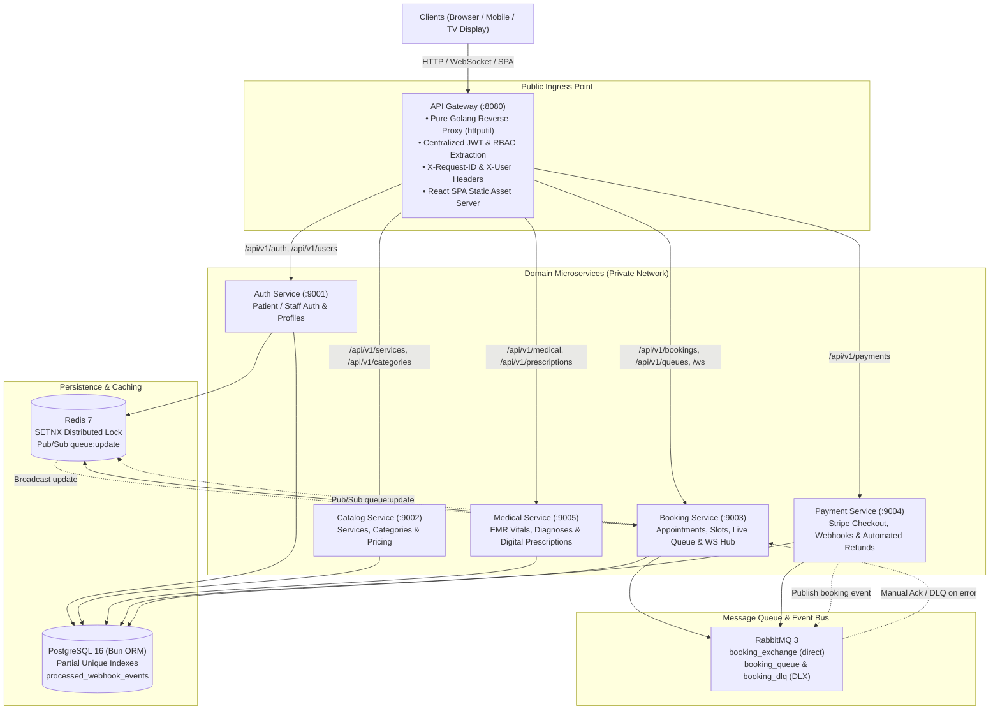

# Clinic Booking & Healthcare Management Platform

A production-ready, event-driven Golang microservices platform for modern outpatient clinic operations. Features an automated patient booking pipeline, Stripe checkout with 4-tier idempotency, high-concurrency race condition prevention, a pure Golang API Gateway, real-time WebSocket waiting room queue boards, and a digital clinical consultation & printable prescription generator.

---

## Architecture Overview



---

## Key Reliability & Concurrency Solutions

### 1. Pure Golang API Gateway (Zero Nginx Dependency)
- Implemented in `backend/cmd/gateway-service/main.go` using standard library `net/http/httputil.ReverseProxy`.
- Serves both dynamic REST/WebSocket API endpoints and the React SPA with HTML5 client-side routing fallback.
- Validates JWT tokens centrally, extracts patient/staff identities, and injects authenticated headers (`X-User-ID`, `X-User-Role`, `X-User-Email`) downstream to microservices.
- Provides unified distributed request tracing via `X-Request-ID`.

### 2. Elimination of Check-Then-Act Race Conditions
When multiple users attempt to book the exact same doctor and time slot simultaneously:
- **Application Tier**: A Redis distributed lock (`SETNX lock:doctor:{id}:{date}:{slot} {token} EX 15`) is acquired prior to slot checking.
- **Database Tier**: Protected by a PostgreSQL partial unique index:
  ```sql
  CREATE UNIQUE INDEX idx_unique_doctor_active_slot 
  ON bookings (doctor_id, booking_date, time_slot) 
  WHERE booking_status IN ('waiting for payment', 'pending payment', 'in progress', 'waiting');
  ```
- Any concurrent collision returns HTTP `409 Conflict` gracefully rather than creating duplicate appointments or inconsistent state.

### 3. Stripe Webhook Idempotency & Network Delay Protection
To address network timeouts, multiple browser checkout clicks, and out-of-order webhook delivery:
- **Deduplication Store**: All received webhook events are recorded atomically in the `processed_webhook_events` table before execution. Duplicate events return an immediate HTTP `200 OK`.
- **Stripe Idempotency Keys**: Checkout sessions and payment intents utilize deterministic idempotency keys (`idempotency_key = "chk_" + patientID + "_" + serviceID + "_" + timestampMinute`).
- **Delayed Webhook Recovery & Auto-Refund**: If a patient abandons a stalled booking and re-books elsewhere, and the delayed webhook arrives for an expired slot, the system automatically marks the transaction and triggers `/api/v1/payments/refund` with Stripe to guarantee zero funds are lost.

### 4. Hardened RabbitMQ Consumer & Dead-Letter Queue (DLQ)
- **Manual Acknowledgments**: Replaced unsafe `autoAck: true` with strict manual acknowledgment (`delivery.Ack(false)`) upon transaction completion.
- **Dead-Letter Exchange (DLX)**: Malformed or unprocessable messages are rejected with `delivery.Nack(false, false)` and forwarded to `booking_dlx` / `booking_dlq` for inspection without blocking production traffic.
- **Payload & Status Sanitization**: Every consumed message validates booking status transitions to prevent invalid state corruption.

---

## Clean Architecture & Package Layout

```
backend/
├── cmd/
│   ├── gateway-service/     # Pure Go API Gateway & SPA server (:8080)
│   ├── auth-service/        # Identity & staff management (:9001)
│   ├── catalog-service/     # Services catalog & pricing (:9002)
│   ├── booking-service/     # Booking lifecycle & WebSocket queue (:9003)
│   ├── payment-service/     # Stripe sessions, webhooks & refund (:9004)
│   ├── medical-service/     # Consultation EMR & prescriptions (:9005)
│   └── main.go              # Monolithic entry point (legacy/fallback)
├── internal/
│   ├── api/                 # HTTP handlers & middleware
│   ├── domain/              # Entities, aggregates, and DTOs
│   ├── usecase/             # Business rules & orchestration
│   └── infrastructure/      # Bun ORM repositories, Redis, RabbitMQ
└── pkg/
    ├── distributed_lock/    # Redis SETNX & atomic Lua release
    ├── idempotency/         # Bun webhook deduplication store
    ├── casbin/              # RBAC role enforcer
    └── common/              # Response wrappers, validators & utils
frontend/
├── src/
│   ├── pages/
│   │   ├── Home/QueueBoardPage.jsx         # Public live waiting room TV board
│   │   ├── Patient/BookingForm.jsx         # Interactive slot booking & checkout
│   │   ├── Doctor/DoctorDashboard.jsx      # Doctor workspace & queue
│   │   ├── Nurse/NurseDashboard.jsx        # Nurse intake workspace
│   │   └── Admin/AnalyticsDashboard.jsx    # Revenue & workload analytics
│   └── components/ui/
│       └── CreateDrugReceiptModal.jsx      # Clinical vitals, diagnosis & Rx print
```

---

## Service Port Matrix

| Service | Port | Primary Responsibilities |
|---|---|---|
| **API Gateway** | `8080` | Public ingress, JWT auth, request routing, SPA serving |
| **Auth Service** | `9001` | Patient/Doctor/Nurse/Admin authentication, profiles |
| **Catalog Service** | `9002` | Categories, subcategories, clinical services |
| **Booking Service** | `9003` | Time-slot reservations, queue management, WebSockets |
| **Payment Service** | `9004` | Stripe Checkout, webhook verification, refunds |
| **Medical Service** | `9005` | Vitals intake, medical records, digital prescriptions |
| **PostgreSQL** | `5432` | Relational database (Bun ORM) |
| **Redis** | `6379` | Distributed locking & queue pub/sub |
| **RabbitMQ** | `5672` / `15672` | AMQP message broker & Management Dashboard |
| **Frontend (Dev)** | `3000` | Vite React development server with HMR |

---

## Getting Started

### 1. Run Everything via Docker Compose (Recommended)

To launch the full microservices stack with all dependencies:

```bash
# Clone the repository
git clone https://github.com/kangourouuu/clinic_booking_service.git
cd clinic_booking_service

# Create local environment config
cp .env.example .env

# Spin up all microservices and infrastructure
docker compose -f docker-compose.microservices.yml up --build
```

Access the services:
- **Application Web UI & Gateway**: [http://localhost:8080](http://localhost:8080)
- **Vite React Dev Server**: [http://localhost:3000](http://localhost:3000)
- **RabbitMQ Management**: [http://localhost:15672](http://localhost:15672) (guest / guest)
- **Public Queue Board**: [http://localhost:8080/queue-board](http://localhost:8080/queue-board)

---

### 2. Local Standalone Development

To run backend services individually without containers:

```bash
# 1. Install dependencies
cd backend && go mod download

# 2. Start API Gateway
go run cmd/gateway-service/main.go

# 3. Start Domain Services in separate terminals
go run cmd/auth-service/main.go
go run cmd/catalog-service/main.go
go run cmd/booking-service/main.go
go run cmd/payment-service/main.go
go run cmd/medical-service/main.go

# 4. Start Frontend
cd ../frontend
npm install --cache ./node_modules/.cache_npm
npm run dev
```

---

## Running Tests

Execute all unit and infrastructure tests:

```bash
cd backend
go test -v ./internal/... ./pkg/...
```

Build the production frontend bundle:

```bash
cd frontend
npm run build
```

---

## License

This project is licensed under the MIT License.
